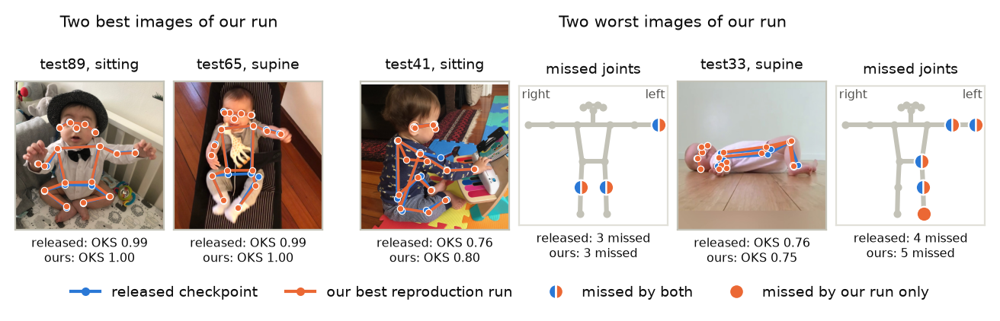

# FiDIP infant pose estimation: a reproduction on SyRIP

This repository reproduces FiDIP ([Huang et al., FG 2021](https://arxiv.org/abs/2010.06100)), an infant pose estimator. The test set is the 100 real test images of [SyRIP](https://coe.northeastern.edu/Research/AClab/SyRIP/) (Test100). It is a course project for EECE 7373 at Northeastern University. Every GPU job ran on one NVIDIA H200 of the Explorer cluster.

| Model | Paper AP | Our AP | How we got our AP |
| --- | ---: | ---: | --- |
| Released HRNet-W48 checkpoint | 93.6 | 93.60 | Our evaluation, `test11.jpg` of the 2023 archive |
| Released MobileNetV2 checkpoint | 79.2 | 79.18 | Our evaluation, `test11.jpg` of the 2023 archive |
| Guide config (fine-tuning) | 92.7 | 91.50 | Our training, final epoch, mean of three runs |
| FiDIP config | 93.6 | 90.43 | Our training, final epoch, mean of three runs |
| Paper-settings config | 93.6 | 91.81 | Our training, final epoch, mean of three runs |
| Best training change | 93.6 | 91.88 | Our training, final epoch, mean of three runs |

Our evaluation of the released checkpoints matches the paper. Our training falls short. `report/report.pdf` explains why.



Left: the two best Test100 images of our best reproduction run. Right: its two worst. Each photo shows the released checkpoint (blue) and our best run (orange). Next to each worst image, a front-facing T-pose marks the joints with an OKS term below 0.5. A half-blue, half-orange dot marks a joint that both models miss.

## Files

| File | Content |
| --- | --- |
| `report/report.pdf` | The report |
| `MANIFEST.md` | The data, weights, checkpoints, jobs, and the commands for each number |
| `SKILL.md` | The cluster workflow |
| `AGENT.md` | The lab notebook of the work with the AI agent |

## Reproduce

1. Install PyTorch 2.3.1 for CUDA 12.1, then run `pip install -r requirements.txt`.
2. Clone the upstream code into `third_party/`:
   ```bash
   git clone https://github.com/ostadabbas/Infant-Pose-Estimation.git third_party/Infant-Pose-Estimation
   git -C third_party/Infant-Pose-Estimation checkout a76b4f418107b8d3548d9779e94702e2508fbef1
   ```
3. Put SyRIP and the weights under the data root in `configs/paths.yaml`. `MANIFEST.md` lists each file and its md5 sum.
4. Run the commands in `MANIFEST.md`.

## Layout

| Folder | Content |
| --- | --- |
| `src/smalldata/` | Shared code: evaluation, OKS, and paths |
| `scripts/` | One script per step |
| `jobs/` | Slurm jobs |
| `configs/` | Training and test configs, and the data paths |
| `results/` | The metrics, predictions, and figures behind the report |
| `report/` | The LaTeX source and the PDF |

The upstream code, the data, and the weights are not part of this repository.
